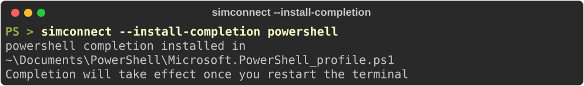
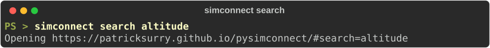
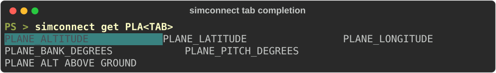
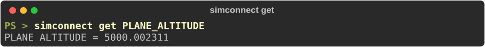
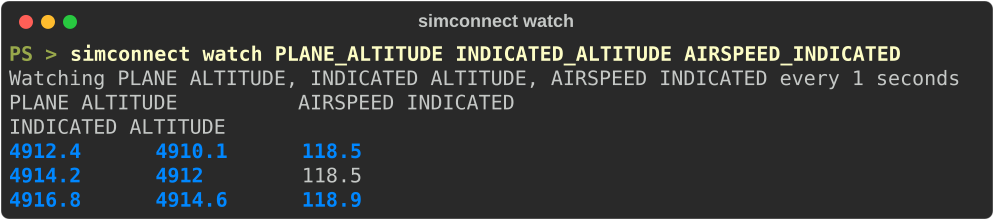
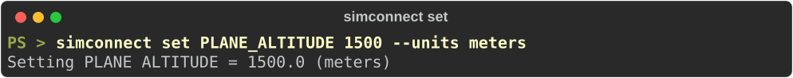
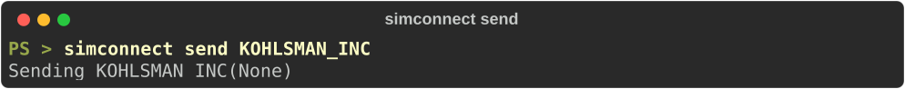

The `pysimconnect` package provides a simple, efficient wrapper for FlightSimulator 2020's
[SimConnect SDK](https://docs.flightsimulator.com/html/index.htm?#t=Programming_Tools%2FSimConnect%2FSimConnect_SDK.htm),
inspired by [Python-SimConnect](https://github.com/odwdinc/Python-SimConnect).

If you're looking to build external instrument displays,
connect custom controllers to FS2020,
or just explore how the simulation works in more detail
then `pysimconnect` is for you.
You might also be interested in [G3](https://github.com/patricksurry/g3),
a flexible Javascript framework for building steam gauge instrument panels.

The package contains a python module called `simconnect`
which exposes a simple pythonic interface
to read simulator variables,
set editable variables,
subscribe to variable changes,
and trigger simulator events.
It also exposes all of the low-level SDK methods,
constants and enumerations from the `SimConnect.h`
SDK API based on a simple automated translation
from the C++ definitions to Python equivalents.

The package also offers a `simconnect` command-line tool
which lets you search for
variables, events and measurement units from the SDK documentation;
inspect, change or watch variables over time;
and send simulator events,
all without writing any code.

Quick start
---

Making sure you're using python 3.6+ and install the package:

    pip install pysimconnect

To use the `simconnect` command-line tool,
install [Powershell7](https://docs.microsoft.com/en-us/powershell/scripting/install/installing-powershell-on-windows?view=powershell-7.2) and
set your [default terminal](https://devblogs.microsoft.com/commandline/windows-terminal-as-your-default-command-line-experience/)
to Windows Terminal rather than Windows Console Host.
Start Powershell7 and install TAB auto-completion support by typing
`simconnect --install-completion powershell`
then restart your terminal as instructed:

Now start a flight in FS2020, perhaps with the AI pilot flying.
Let's experiment with reading and modifying the altitude.
First let's find some relevant variables in the interactive [SimVar Explorer](https://patricksurry.github.io/pysimconnect/) with `search`:

Nice!  That opens the web explorer showing results from the SDK documentation ranked by relevance.
Result categories are distinguished by different colors and symbols, e.g.
variables 🧭, events ⚙️ and units 📐, with a ✏️ marking variables which we can change, plus one-click buttons to copy Python or CLI snippets.

Now let's read the value of the `PLANE ALTITUDE` variable using the `get` command.
Start typing `simconnect get PLA<TAB>`, hitting the TAB key part way through the variable name
to see contextual auto-complete options:

Select the desired `PLANE_ALTITUDE` option and hit ENTER:

Note that although the underlying SDK variables are space-separated
and events are underscore-separated,
the command-line tool recognizes either version.
Normally using underscore-separated everywhere will be easier for auto-completion
and avoids quoting in the terminal.

We can read multiple variables by just appending them in a list.
We can also monitor multiple variables over time using `watch`:

By default we'll see an update once every second,
highlighting the variables that change during each update.
Some commands support additional options,
for example `simconnect watch --help` will show us how to change the
monitoring interval time.
For general help, try `simconnect --help`.

Now let's change the plane's altitude during flight(!) using the `set` command.
Here we'll add the `--units` option to specify that our value is measured in `meters` rather
than the default `feet`:

Lastly, let's send an event to FS2020.
A simple example is to bump the altimeter adjustment knob, like so.
If you send this event a few times, you'll see the indicated altitude adjust in response.

This simple event needs no data, but with others you also need to provide a value.

You can also launch a live [G3](https://github.com/patricksurry/g3) steam-gauge instrument panel server directly from the CLI:

    simconnect serve --port 8000

Then open `http://localhost:8000` in any browser (or on a tablet/Raspberry Pi on your LAN) to view live navigation and radio-nav gauges, with knobs and switches that control the sim. The server is a [G3 hub](https://github.com/patricksurry/g3/blob/master/doc/API.md#hubs): panels read metrics from `/stream` (Server-Sent Events) or `/metrics.json`, and send `set` / `adjust` / `trigger` actions to `/inputs`, which are mapped to SimVar writes and events by [`simconnect/g3/config.json`](simconnect/g3/config.json). If MSFS 2020 is not running (or on macOS/Linux), `simconnect serve --mock` streams realistic synthetic flight telemetry.

Working with python
---

The command-line tool is just a lightweight
wrapper for some features of the `simconnect` python package.
This means that you can write simple python code to do anything
the command-line tool does, and much more besides.
The best way to get started is to browse some [examples](examples/README.md)
which show both low-level interaction with the SDK,
and some of the simplified sugar the package offers,
or consult the [API & Architecture Reference](docs/reference.md) and interactive
[SimVar Explorer](docs/index.html) (`simconnect search`).

With so many moving parts, debugging errors can sometimes be tricky.
One useful tool is to set the `LOGLEVEL` environment variable
to `DEBUG` before running your code, rather than the default `INFO`:

    set LOGLEVEL=DEBUG

Also, be warned that the official
[SDK documentation](https://docs.flightsimulator.com/html/index.htm?#t=Programming_Tools%2FSimConnect%2FSimConnect_SDK.htm_)
has various errors (copy/paste gone wrong?)
which can make it difficult to understand some details.
Where possible refer directly to the `SimConnect.h`
header file definitions and comments
as a more authoritative source.

What's what?
---

Find the full source on github at https://github.com/patricksurry/pysimconnect.
The `simconnect` folder contains the package itself.

The main interface is defined in `sc.py` which wraps the raw
definitions from the auto-generated `scdefs.py`,
providing access to both the low-level
SDK functions as well as some pythonic sugar.
The command line tool is implemented by `cli.py`.

The package requires a copy of `SimConnect.dll` to work.
This normally ships with FS2020 but a recent copy is also included here.
You can point to your own version by specifying the `dll_path` argument
when initializing `SimConnect(...)`.
When bundling an application with `PyInstaller` (especially in single-file `-F` mode), include the package's JSON metadata and DLL via `--collect-all simconnect` (or `--add-data ".../simconnect/*.json;./simconnect" --add-binary ".../simconnect/SimConnect.dll;./simconnect"`).
The `scvars.json` file lists all the simulation variables (SimVars),
events and dimensional units, which were scraped from the SDK documentation pages
using `scripts/scrapevars.py`.  This is useful for finding content
you want to interact with, inferring missing units and data-types
when querying simulation variables, and sanity-checking variable names.

The `docs` folder contains the [API & Architecture Reference](docs/reference.md)
and a self-contained static [SimVar Explorer & Docs site](docs/index.html) suitable
for hosting on GitHub Pages.

The `examples` folder contains various illustrations of how to use
the package, showing both low-level SDK access and the pythonic wrappers.
See the `README.md` there for more details.

The `scripts` folder includes several scripts used to generate
parts of the package.
The `genscdefs.py` script creates `scdefs.py` from a post-processed
version of the `SimConnect.h` C++ header that ships with the SDK
(which can be installed via the Options > General > Developer tools help menu).
This generates a python translation of all the SDK function declarations, data structures
and enumerated constants.  The automated translation is quite fragile:
it assumes the header is formatted in a particular way, and has been
pre-processed with `cpp` to `SimConnect_cpp.h` from the raw header.
This approach makes it easy to tweak the rules for mapping from C++
to Python, as long as header format doesn't change significantly.

Testing and remote connectivity
---

Install the development tools and run the unit tests via `pytest`:

    pip install -e ".[dev]"
    python3 -m pytest -v

Code is linted and formatted with [ruff](https://docs.astral.sh/ruff/) and type checked with [mypy](https://mypy.readthedocs.io/),
both configured in `pyproject.toml`. Run them directly with `ruff check`, `ruff format` and `mypy`,
or install the [pre-commit](https://pre-commit.com/) hooks once so they run on every commit:

    pre-commit install

The same checks and tests run in CI on every pull request, on python 3.10 and 3.13.

Live integration tests in `tests/test_live_msfs.py` run automatically when `SimConnect.dll` can connect to a running MSFS 2020 instance, and are skipped otherwise (e.g. on macOS/Linux or when MSFS is not running).

When running tests remotely over SSH on a Windows machine where `FlightSimulator.exe` is running in the interactive desktop session (`Session 1`), `sshd` runs in `Session 0` and cannot see the default local named pipe. Create a `SimConnect.cfg` in the working directory to connect over MSFS's local TCP port (`127.0.0.1:500`):

    [SimConnect]
    Protocol=IPv4
    Address=127.0.0.1
    Port=500

For passwordless SSH to a Windows host where your user is in the `Administrators` group, OpenSSH reads authorized keys from `C:\ProgramData\ssh\administrators_authorized_keys` (with ACLs restricted to `Administrators` and `SYSTEM`), and Windows Firewall must allow inbound TCP port 22 (e.g. Private network profile).

Packaging and distribution
---

Bump version in `setup.cfg` then following https://packaging.python.org/en/latest/tutorials/packaging-projects/

    uv build --out-dir dist
    git commit -am ...
    git push origin
    git tag v0.3.0
    git push origin --tags
    uvx twine upload dist/*0.3.0*
    # login with username: __token__ / password: pypi-...

